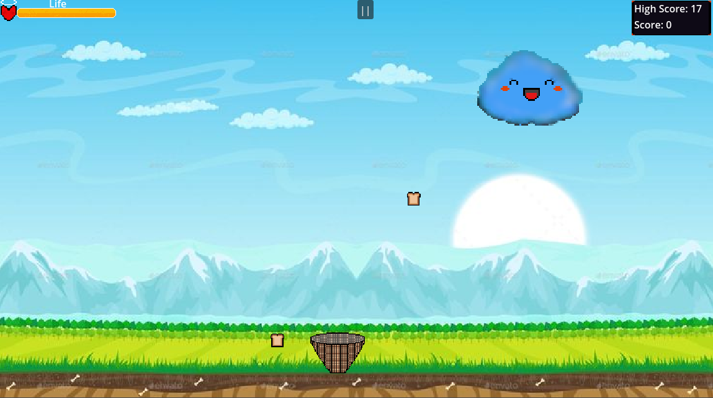
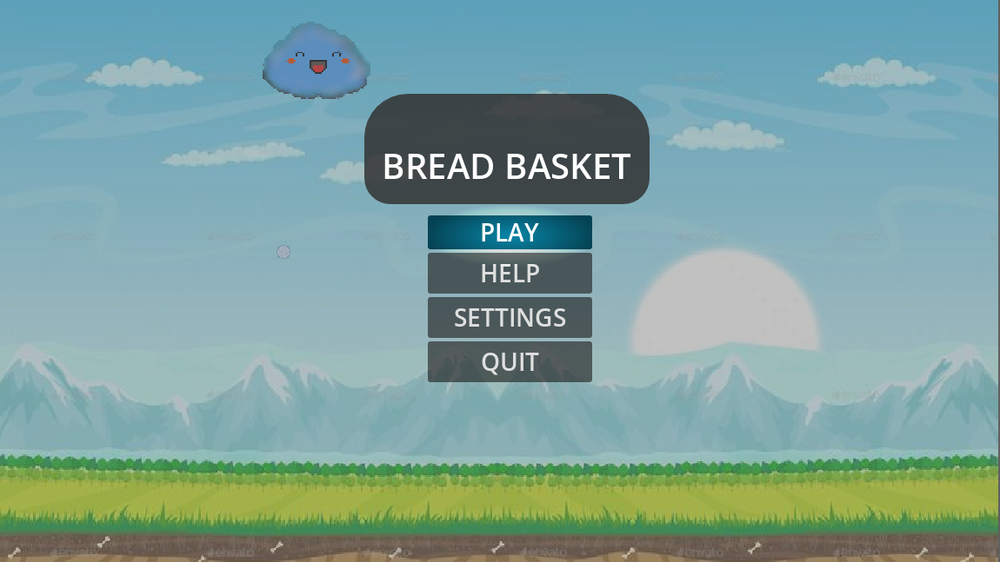
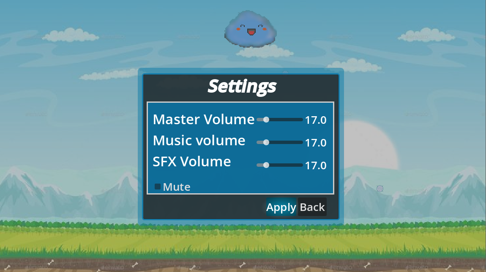
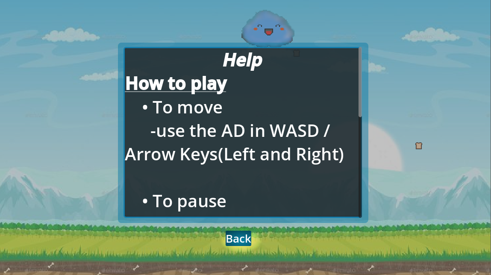

# **Bread BAsket**


A 2D side-view where the cloud gives bread and hailstone, move the basket to catch the bread dodge the stones before you break the basket
---


## features
- Responsive movement
- Randomized movement and timing
- Sound effects and music
- Cute art 😅

## Preview
<p align="center">

</p>

## MainMenu
<p align="center">

</p>

## Settings
<p align="center">

</p>

## Help
<p align="center">

</p>

# Controls
| Action | Keyboard |
|--------|-----------|
| Move   | AD / Arrow Keys(Left and Right) |

# Project Structure
Explore the full directory tree: [View on GitHub](https://github.com/maltech0005-tech/Bread-Busket/tree/main)

```text
The-Fading-Ember/
├── assets/
├── scenes/
├── script/
├── export_presets.cfg
├── icon.svg
├── project.godot
└── README.md
```
---

# Live Demo
Go play it on itch [BreadBasket](https://anotida1.itch.io/bread-basket)

# Ai Usage
- This project is fully human written, no copy and paste or typying of code directly from ai source was practiced.

# Assets Sources
- All sprites were originally designed and created using [libresprite](https://libresprite.github.io) ([Aseprite](https://www.aseprite.org) alternative) except for the game background which was out sourced.
- All sounds were freely downloaded from  from https://pixabay.com
- Background music [click here](https://pixabay.com/music/cartoons-cartoon-cartoons-music-595946/)
- Hail stone crash [click here](https://pixabay.com/sound-effects/film-special-effects-car-crash-sound-376882/)
- Bread catch [click here](https://pixabay.com/sound-effects/people-yay-6120/)
- GameOver [click here](https://pixabay.com/sound-effects/musical-kl-bells-game-over-ii-416385/)

